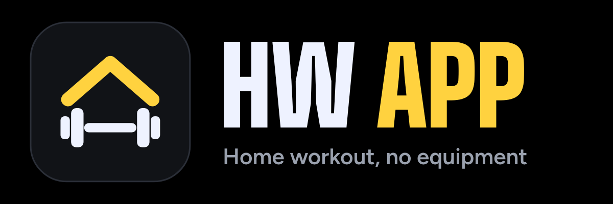
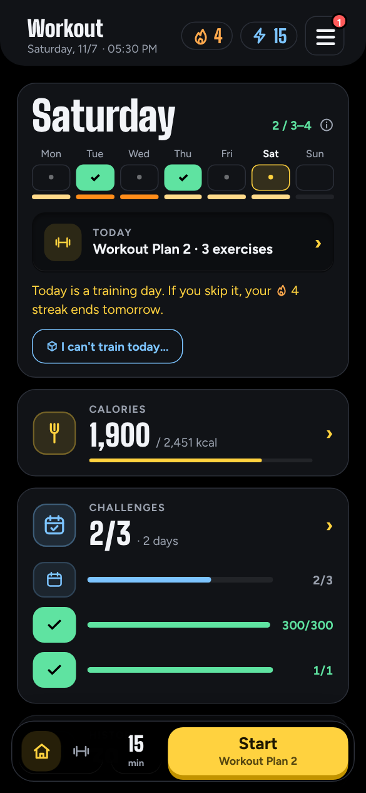
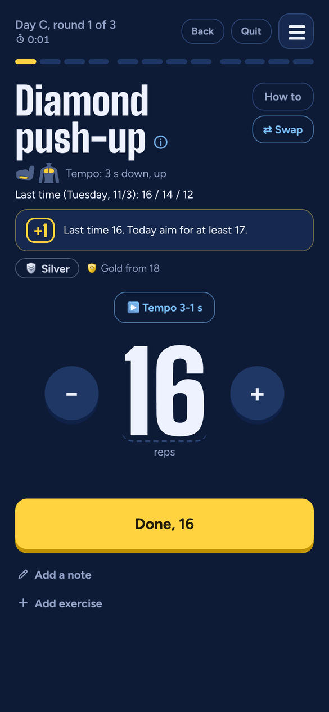
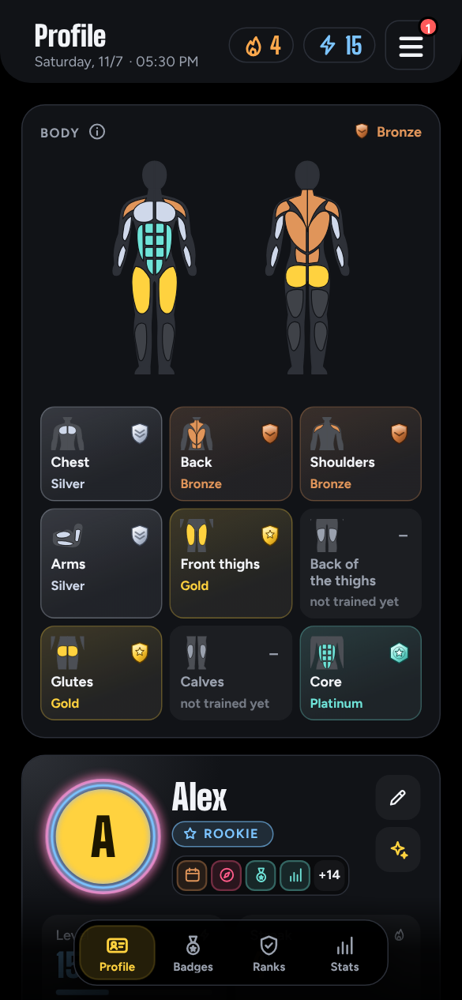
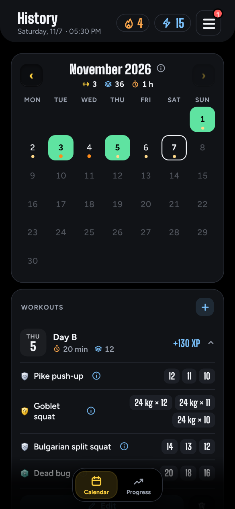
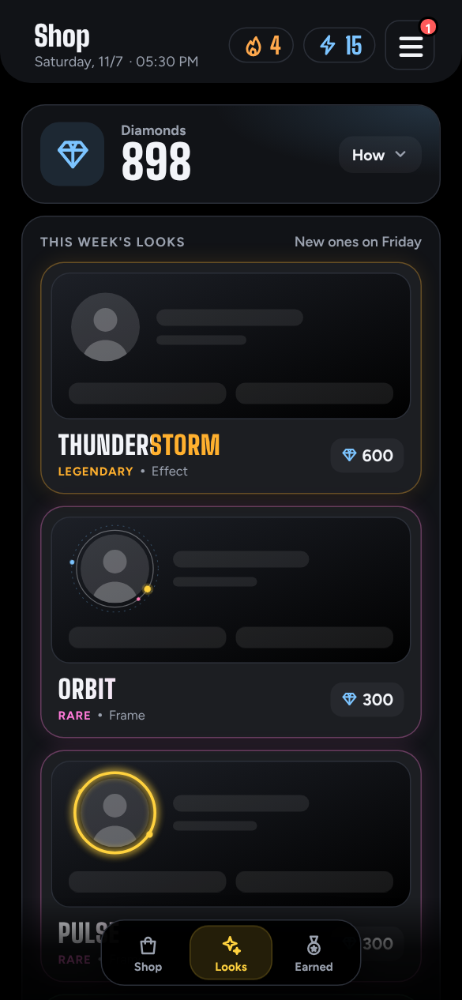
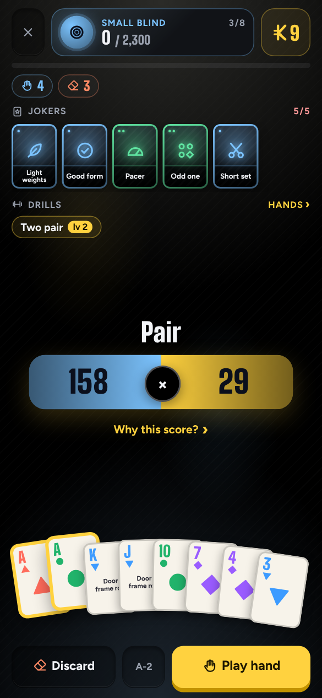
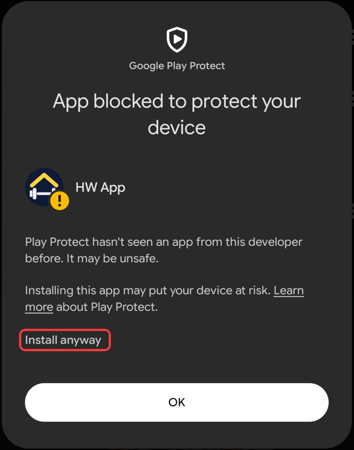

  
  
  
  
  

<h3 align="center">A workout plan that grows with you</h3>

Train at home with no equipment in under 20 minutes. Got dumbbells or a gym? Build your own plans with them.

  <a href="https://play.google.com/store/apps/details?id=io.github.mikydon.hwapp"><b>▶️ Google Play</b></a> &nbsp;•&nbsp;
  <a href="https://github.com/mikydon/hw-app/releases/latest"><b>⬇️ APK</b></a> &nbsp;•&nbsp;
  <a href="https://mikydon.github.io/hw-app/"><b>🌐 Website</b></a> &nbsp;•&nbsp;
  <a href="CHANGELOG.md"><b>📝 What's new</b></a>

  
  
  
  
  
  

---

## ✨ What's inside

| | What you get |
|---|---|
| 🗓️ **Plans** | A ready plan (days A, B, C every other day: push, pull, legs, core, ~19 min) or your own workouts, set to the days of your week. |
| 💪 **134 exercises** | Bodyweight, dumbbells, kettlebells, bands, a pull-up bar, gym machines and cables, in body-part groups with a search that knows other names too. |
| 📈 **Beat last time** | Every set starts at last time's number with a **+1 goal**. Weights log kg × reps and tell you when to go heavier. |
| ⏱️ **Rest that waits** | +15 / +30 / +60 s, counts on after 0 and saves your real rest. In the app it runs on the lock screen and beeps with the screen off. |
| 🏆 **Ranks and badges** | Every exercise ranks from Iron to Obsidian, 9 body parts get ranks on a drawing of your body, 49 badges (some secret 🤫). |
| 🔥 **Streaks** | Train every other day to keep the streak; freezes save it when life happens. |
| 📅 **History** | A month calendar of your workouts, every set you did, and a progress chart for each exercise. |
| 📊 **Stats** | 12 weeks day by day, weekly charts, your best weekdays, calories at a glance. |
| 🍎 **Calories** | Daily target (Mifflin-St Jeor) with your workouts added, a food log and Health Connect (steps, weight, food). |
| 👥 **Friends** | An optional account: friends, messages, friend streaks, a leaderboard and a profile they can open, with your last workout. |
| 🃏 **Muscle Deck** | A card game powered by your training: higher ranks, stronger cards. 80 jokers, bosses, vouchers, drills, a shop and a practice game. |
| 💎 **Shop** | Diamonds you earn by training: streak freezes, XP boosts and 91 profile looks (frames, banners, titles, name effects, animated effects). |
| 🎨 **Yours** | 8 dark themes (pure black by default), 6 main colours, 6 card styles, 15 languages and a guide that shows you around. |

## 📲 Get the app (Android 8.0+)

**Google Play (easiest):** [HW App: Home Workout](https://play.google.com/store/apps/details?id=io.github.mikydon.hwapp). Updates come through Play.

**APK from GitHub:**

1. Open the [newest release](https://github.com/mikydon/hw-app/releases/latest) on your phone and download **HW-App-x.y.z.apk**.
2. Open it. If Android asks, allow installing apps from your browser.
3. If Play Protect says *App blocked to protect your device*, tap **Install anyway** (sometimes under *More details*).

📷 Show me the Play Protect screen

 

With the APK, small updates arrive inside the app by themselves; for a big one the app downloads the new APK for you. Your data stays.

Both are the same app, signed with the same key. An account (optional) keeps your data in sync between phones and the website.

## 🌐 Website (any phone, also iPhone)

Open **[mikydon.github.io/hw-app](https://mikydon.github.io/hw-app/)** and add it to your home screen (Android Chrome: ⋮ → *Install app*; iPhone Safari: Share → *Add to Home Screen*). It works offline too. Sign in to the same account in the app and on the website and they stay in sync.

📱 What only the Android app can do

- the rest timer on the lock screen, with a beep and vibration while the screen is off
- Health Connect (steps, weight, height, food from other apps)
- notifications for messages, friend requests and new versions
- backups saved in a folder on your phone, also automatically
- 120 Hz, the same text size for everyone, vibration that works with touch feedback off

## 🔒 Privacy

Without an account, everything stays on your device. An account (optional, 16+) adds friends, messages, a profile page (you choose who sees it) and a cloud backup on Google Firebase, with restore points. Health Connect data never leaves your phone. The lock-screen rest timer asks for *Physical activity* only because Android requires it for that kind of timer; the app reads no activity data with it. Full policy: [privacy.html](https://mikydon.github.io/hw-app/privacy.html) · [delete your account](https://mikydon.github.io/hw-app/delete-account.html).

## 🌍 Languages

English, Slovenčina, Čeština, Polski, Magyar, Українська, Deutsch, Español, Français, Italiano, Português, 中文（简体）, 日本語, 한국어, Bahasa Indonesia. The app follows your phone's language. Found a mistake or missing yours? See [TRANSLATING.md](TRANSLATING.md).

## 💬 Ideas and bugs

HW App is made by one developer. Found a bug or have an idea? [Open an issue](https://github.com/mikydon/hw-app/issues) or write to hwapp.support@gmail.com.

<b>🛠️ For developers</b>

- Source: `src/App.jsx` (React, the whole app), entry `src/main.jsx`; Android shell in `android/` (Capacitor); the card game's rules in `src/game/engine.js`.
- Texts: `src/i18n/<lang>.js`. English (`en.js`) is the base; every other language falls back to it key by key.
  - To add a language: copy `en.js`, translate it, add it to `LANGS` and `SOURCES` in `src/i18n/index.js`, then run `node src/i18n/check.mjs <code>` (it checks keys, placeholders and plural forms).
- Build: `npm install`, then `npm run build`. This creates `index.html` with everything in one file (only English sits in the script; the other languages are read when needed).
- Tests: `node tools/<name>_test.mjs` (logic: sync, plans, economy, the game) and `node tests/<name>_test.mjs` (the built page in Chromium through Playwright).
- The site runs on GitHub Pages from the `main` branch, folder `/` (root). Every push builds the APK in GitHub Actions.
- Logo and icons: `assets/mark.svg` (logo), `assets/icon-maskable.svg` (Android icon), `assets/logo-wordmark.svg`; `node tools/brand/icons.mjs` renders every size.
- Emoji: the emoji the app shows come from `fonts/hw-emoji.ttf`, made from Microsoft's [Fluent Emoji](https://github.com/microsoft/fluentui-emoji) 3D set (MIT licence, `tools/emoji/LICENSE-fluent-emoji.txt`) by `tools/emoji/build_font.py` (uses Google's `emoji_builder.py`, Apache 2.0). Chat messages keep the phone's emoji.

## 🙏 Credits
- Emoji: [Fluent Emoji](https://github.com/microsoft/fluentui-emoji) © Microsoft Corporation, MIT licence.
- Fonts: Big Shoulders Display, Figtree and Oswald (SIL Open Font License), from [Fontsource](https://fontsource.org).
